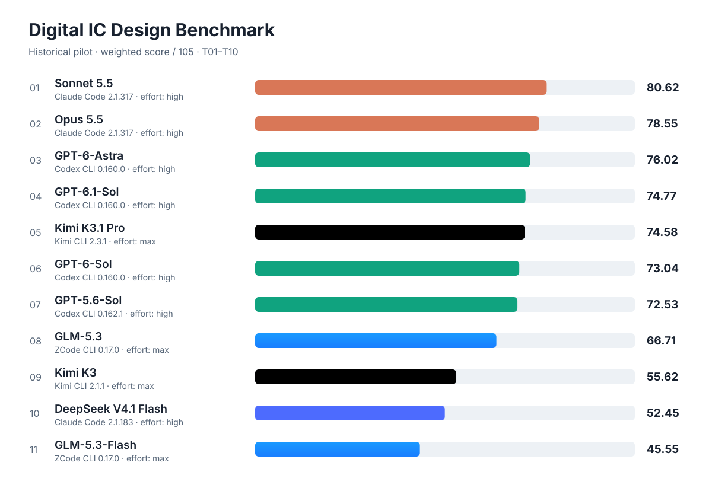

# 模型评测结果 · v0.3（2026-11-06）

本页汇总十一个模型的 T01–T10 成绩。

## 成绩总表

每题满分 105：功能 50、PPA 50、时间 5；显示分已计入交付扣分。表中保留两位小数，加权总分使用未舍入值计算。框架版本来自原始运行记录。

模型名括号内为思考强度；`default` 表示未显式指定，沿用默认设置。不同框架的档位不代表同等推理预算。

| 题目 | 权重 | GPT-6-Astra(high) Codex CLI 0.160.0 | GPT-6.1-Sol(high) Codex CLI 0.160.0 | GPT-6-Sol(high) Codex CLI 0.160.0 | GPT-5.6-Sol(high) Codex CLI 0.162.1 | Kimi K3.1 Pro(max) Kimi CLI 2.3.1 | Kimi K3(max) Kimi CLI 2.1.1 | DeepSeek V4.1 Flash(high) Claude Code 2.1.183 | GLM-5.3-Flash(max) ZCode CLI 0.17.0 | GLM-5.3(max) ZCode CLI 0.17.0 | Sonnet 5.5(high) Claude Code 2.1.317 | Opus 5.5(high) Claude Code 2.1.317 |
| --- | ---: | ---: | ---: | ---: | ---: | ---: | ---: | ---: | ---: | ---: | ---: | ---: |
| T01 | 3% | 88.24 | 86.33 | 86.98 | 87.20 | 52.48 | 75.49 | 82.86 | 63.93 | 64.96 | 90.28 | 89.01 |
| T02 | 3% | 87.88 | 87.20 | 89.70 | 88.65 | 87.02 | 89.17 | 89.07 | 87.10 | 89.28 | 89.06 | 88.63 |
| T03 | 6% | 91.08 | 91.18 | 89.80 | 89.62 | 90.01 | 89.96 | 90.88 | 87.87 | 89.28 | 89.61 | 89.40 |
| T04 | 6% | 97.27 | 86.90 | 91.12 | 67.05 | 75.57 | 68.13 | 62.63 | 69.14 | 66.46 | 92.76 | 91.95 |
| T05 | 6% | 89.72 | 88.93 | 90.12 | 90.35 | 89.22 | 89.18 | 90.00 | 39.00 | 89.15 | 90.29 | 90.01 |
| T06 | 10% | 94.78 | 93.70 | 96.22 | 90.76 | 93.00 | 25.00 | 92.93 | 82.15 | 94.61 | 98.26 | 97.06 |
| T07 | 10% | 93.49 | 93.12 | 88.44 | 83.35 | 88.89 | 81.88 | 92.50 | 88.69 | 88.39 | 83.89 | 71.27 |
| T08 | 11% | 87.89 | 87.14 | 84.21 | 85.83 | 85.03 | 84.30 | 46.83 | 85.87 | 45.00 | 84.44 | 87.27 |
| T09 | 20% | 60.51 | 59.20 | 56.25 | 87.43 | 75.31 | 40.00 | 44.93 | 13.67 | 59.03 | 96.35 | 90.97 |
| T10 | 25% | 53.83 | 53.73 | 50.00 | 32.39 | 50.00 | 31.53 | 0.00 | 0.00 | 49.34 | 48.44 | 49.24 |
| **加权总分 /105** | **100%** | **76.02** | **74.77** | **73.04** | **72.53** | **74.58** | **55.62** | **52.45** | **45.55** | **66.71** | **80.62** | **78.55** |
| **功能全通过题数** | — | **10/10** | **10/10** | **10/10** | **9/10** | **10/10** | **7/10** | **7/10** | **7/10** | **8/10** | **9/10** | **9/10** |

## 运行条件与可比性

- 若存在谬误欢迎指正；
- T10 的PPA评分仅测单 PE，但完整 256-PE DUT 仍需通过功能、结构与吞吐验收。参考使用内部硬宏，候选使用展平 PE，实现流程差异尚缺同流程对照。
- Kimi T08 的历史累计开发预算为 150 分钟，其余运行预算见各模型归档。
- GPT-6-Sol T10 按历史功耗编译终止裁定保留功能 50 分、PPA/时间 0 分；该裁定不追溯套用新编译时限。
- Kimi K3.1 Pro(max) 的 T10 功能全部通过；没有种子在各自评估时限内完成物理实现，因此 PPA/时间为 0。
- Sonnet 5.5 的 T10 严格功能分已修订为 48.44；原有 40 分钟功耗编译超时导致的 PPA/时间 0 分保留，不限时诊断结果不参与计分。

## 各模型逐题失分原因

参考实现的 PPA 为 35/50，未获满分不必然表示功能缺陷。表中倍数为候选值除以同题参考值；时序惩罚取三种子最差裕量，面积、延迟、能耗取中位数。时间分使用开发耗时；功能未全通过时，PPA 和时间分为 0。

### Opus 5.5(high)（Claude Code 2.1.317）

数据：[summary.json](claude-opus-5.5/summary.json)。使用英文题面、CLI 自带技能，与 Sonnet 相同的初始公共输入。T01–T09 功能各 50 分；T10 的 64 个抵消用例通过，但额外 82 个严格范围探针失败 36 个。当前严格功能分为 49.240255/50；MMA 诊断通过不替代本版严格判定。单 PE PPA/时间沿用功耗编译超时的 0 分，不限时诊断已由用户停止且不参与计分。

| 题目 | 功能 | PPA | 时间 | 显示分 |
| --- | ---: | ---: | ---: | ---: |
| T01 | 50.00 | 37.02 | 1.99 | 89.01 |
| T02 | 50.00 | 34.37 | 4.26 | 88.63 |
| T03 | 50.00 | 35.58 | 3.82 | 89.40 |
| T04 | 50.00 | 37.98 | 3.96 | 91.95 |
| T05 | 50.00 | 36.31 | 3.70 | 90.01 |
| T06 | 50.00 | 43.72 | 3.34 | 97.06 |
| T07 | 50.00 | 22.20 | 4.07 | 71.27 |
| T08 | 50.00 | 34.37 | 2.90 | 87.27 |
| T09 | 50.00 | 38.79 | 2.18 | 90.97 |
| T10 | 49.24 | 0.00 | 0.00 | 49.24 |

### Sonnet 5.5(high)（Claude Code 2.1.317）

数据：[summary.json](claude-sonnet-5.5/summary.json)。十题通过原功能验收集，无交付扣分；题目使用英文，仅启用 CLI 自带技能。补充审计已在原始完整 DUT 上复现 BF16、MXFP8 和 MXFP4 的抵消后溢出错误：146 个补充矩阵用例失败 70 个，两套独立参考一致。下表已按更新后的默认功能验收器重算；该比例只描述定向用例，不代表随机输入错误率。

| 题目 | 功能 | PPA | 时间 | 显示分 |
| --- | ---: | ---: | ---: | ---: |
| T01 | 50.00 | 37.07 | 3.21 | 90.28 |
| T02 | 50.00 | 34.50 | 4.56 | 89.06 |
| T03 | 50.00 | 35.29 | 4.32 | 89.61 |
| T04 | 50.00 | 38.76 | 4.01 | 92.76 |
| T05 | 50.00 | 35.77 | 4.52 | 90.29 |
| T06 | 50.00 | 44.06 | 4.19 | 98.26 |
| T07 | 50.00 | 29.65 | 4.24 | 83.89 |
| T08 | 50.00 | 33.41 | 1.03 | 84.44 |
| T09 | 50.00 | 45.68 | 0.67 | 96.35 |
| T10 | 48.44 | 0.00 | 0.00 | 48.44 |

T10 完成三个种子的单 PE 物理实现；完整 DUT 功耗模型在种子 11 的外围逻辑代码生成阶段耗尽 40 分钟编译预算，尚未进入实际功耗仿真。功能分已修订为 48.44，PPA 与时间分沿用原判分 0。不限时诊断结果独立保存，不回写成绩。

### Kimi K3.1 Pro(max)（Kimi CLI 2.3.1）

数据：[summary.json](kimi-k3.1-pro/summary.json)。功能 /50，PPA /50，时间 /5；交付扣分计入显示总分。

| 题目 | 功能 | PPA | 时间 | 主要失分原因或未满分说明 |
| --- | ---: | ---: | ---: | --- |
| T01 | 50.00 | 0.46 | 2.02 | 面积、延迟分别约为参考的 3.35、3.06 倍，最差 setup 裕量为 −1.331180 ns，PPA 几乎被时序惩罚耗尽。 |
| T02 | 50.00 | 34.65 | 2.37 | 面积、能耗分别约为参考的 1.03、1.05 倍，延迟略优于参考。 |
| T03 | 50.00 | 37.04 | 2.96 | 面积、延迟和能耗均不高于参考，PPA 为 37.04。 |
| T04 | 50.00 | 22.41 | 3.16 | 面积和能耗分别约为参考的 1.41、2.09 倍，最差 setup 裕量为 −0.019275 ns。 |
| T05 | 50.00 | 35.95 | 3.27 | 功能和物理检查通过，面积接近参考，延迟与能耗略优。 |
| T06 | 50.00 | 39.56 | 3.44 | 面积和能耗分别约为参考的 0.73、0.79 倍；延迟约为参考的 1.17 倍。 |
| T07 | 50.00 | 35.79 | 3.10 | 面积约为参考的 1.20 倍，能耗约为参考的 0.74 倍；时序与 DRC 合格。 |
| T08 | 50.00 | 33.90 | 1.13 | 面积和能耗接近参考，延迟约为参考的 1.09 倍；开发约 92.9/120 分钟。 |
| T09 | 50.00 | 25.18 | 0.13 | 最差 setup 裕量为 −0.066677 ns，面积、延迟分别约为参考的 1.13、1.08 倍；开发接近 120 分钟时限。 |
| T10 | 50.00 | 0.00 | 0.00 | 严格范围复核已更新；PPA/时间保留原裁定。 |

### GPT-5.6-Sol(high)（Codex CLI 0.162.1）

数据：[summary.json](gpt-5.6-sol/summary.json)。功能 /50，PPA /50，时间 /5；交付扣分计入显示总分。

| 题目 | 功能 | PPA | 时间 | 主要失分原因或未满分说明 |
| --- | ---: | ---: | ---: | --- |
| T01 | 50.00 | 33.16 | 4.04 | 面积、延迟和能耗分别约为参考的 1.06、1.07、1.04 倍。 |
| T02 | 50.00 | 34.43 | 4.22 | 面积和能耗均约为参考的 1.03 倍；时序及 DRC 合格。 |
| T03 | 50.00 | 34.93 | 4.68 | 指标整体接近参考，面积和能耗约高 2%，延迟略优。 |
| T04 | 50.00 | 12.43 | 4.62 | 面积约为参考的 3.41 倍、能耗约为 5.57 倍，且最差 setup 裕量为 −0.016145 ns。 |
| T05 | 50.00 | 35.69 | 4.67 | 功能和物理检查通过，延迟与能耗略优于参考。 |
| T06 | 50.00 | 36.07 | 4.70 | 面积和能耗低于参考，但延迟约为参考的 1.19 倍。 |
| T07 | 50.00 | 28.64 | 4.70 | 最差 setup 裕量为 −0.058237 ns，面积和延迟分别约为参考的 1.10、1.08 倍。 |
| T08 | 50.00 | 33.44 | 2.39 | 三种子时序、DRC 和功耗标注均通过；延迟约为参考的 1.14 倍。 |
| T09 | 50.00 | 35.57 | 1.86 | PPA 接近参考且时序、DRC 合格；开发约 75.3/120 分钟，时间分 1.86。 |
| T10 | 32.39 | 0.00 | 0.00 | 严格范围复核已更新；PPA/时间保留原裁定。 |

### GLM-5.3-Flash(max)（ZCode CLI 0.17.0）

数据：[summary.json](glm-5.3-flash/summary.json)。功能 /50，PPA /50，时间 /5；交付扣分计入显示总分。

| 题目 | 功能 | PPA | 时间 | 主要失分原因或未满分说明 |
| --- | ---: | ---: | ---: | --- |
| T01 | 50.00 | 23.93 | 0.00 | 功能与 PPA 均通过；缺少 `run.sh`、`README.md`、`results.json`，显示分扣 10 分。 |
| T02 | 50.00 | 34.75 | 2.35 | 功能和物理检查通过；开发约 31.8/60 分钟。 |
| T03 | 50.00 | 36.15 | 1.72 | 功能和物理检查通过；开发约 59.0/90 分钟。 |
| T04 | 50.00 | 16.66 | 2.48 | 功能和物理检查通过；PPA 相对较低。 |
| T05 | 39.00 | 0.00 | 0.00 | 参数化组仅过半，复位组部分失败，CDC 安全组未通过；PPA/时间因功能门槛归零。 |
| T06 | 50.00 | 30.24 | 1.91 | 功能和物理检查通过；PPA 低于参考。 |
| T07 | 50.00 | 38.57 | 0.11 | 功能和物理检查通过；开发接近 120 分钟时限。 |
| T08 | 50.00 | 34.21 | 1.66 | 功能和物理检查通过；开发约 80.2/120 分钟。 |
| T09 | 23.67 | 0.00 | 0.00 | 存储、CSR/异常、ACT4 与流水线周期组失分；另缺 `run.sh`、`README.md` 且自检结果格式错误，显示分扣 10 分。 |
| T10 | 0.06 | 0.00 | 0.00 | 严格范围复核已更新；PPA/时间保留原裁定。 |

### GLM-5.3(max)（ZCode CLI 0.17.0）

数据：[summary.json](glm-5.3/summary.json)。T01 缺少三项交付物，扣 10 分；PPA 使用评测方补写的运行脚本测得。T08 的 VLAN 准入、配置快照、元数据和复位恢复均有未通过项，功能分 45 分。T10 146 个补充用例通过 115 个，严格功能分修订为 49.34；三个种子的物理实现及功耗流程触发 40 GiB 上限的原记录保留，PPA 和时间分仍为 0。其余逐题分项见汇总。

| 题目 | 功能 | PPA | 时间 | 主要失分原因或未满分说明 |
| --- | ---: | ---: | ---: | --- |
| T01 | 50.00 | 24.96 | 0.00 | 缺少三项交付物，扣 10 分；开发时间用满。 |
| T02 | 50.00 | 35.74 | 3.54 | PPA 接近参考，时间分 3.54。 |
| T03 | 50.00 | 35.93 | 3.35 | PPA 接近参考，时间分 3.35。 |
| T04 | 50.00 | 13.26 | 3.20 | PPA 13.26，低于参考分。 |
| T05 | 50.00 | 35.53 | 3.62 | PPA 接近参考，时间分 3.62。 |
| T06 | 50.00 | 41.37 | 3.24 | PPA 优于参考，时间分 3.24。 |
| T07 | 50.00 | 36.09 | 2.30 | PPA 接近参考，时间分 2.30。 |
| T08 | 45.00 | 0.00 | 0.00 | VLAN、配置快照、元数据及复位恢复未全通过。 |
| T09 | 50.00 | 7.09 | 1.94 | 功能全过，PPA 7.09。 |
| T10 | 49.34 | 0.00 | 0.00 | 严格范围复核已更新；PPA/时间保留原裁定。 |

### DeepSeek V4.1 Flash(high)（Claude Code 2.1.183）

数据：[summary.json](deepseek-flash/summary.json)。功能 /50，PPA /50，时间 /5；交付扣分计入显示总分。

| 题目 | 功能 | PPA | 时间 | 主要失分原因或未满分说明 |
| --- | ---: | ---: | ---: | --- |
| T01 | 50.00 | 30.09 | 2.77 | 面积、能耗分别为参考的约 1.23、1.25 倍；时间分 2.77。 |
| T02 | 50.00 | 35.19 | 3.88 | 功能和物理检查通过，PPA 接近参考；时间分 3.88。 |
| T03 | 50.00 | 36.38 | 4.50 | 功能和物理检查通过；PPA 36.38，时间分 4.50。 |
| T04 | 50.00 | 13.17 | 4.46 | 最差 setup 裕量 −0.185842 ns，能耗约为参考的 1.73 倍；run.sh 的 OBJCACHE 未定义，交付扣 5 分。 |
| T05 | 50.00 | 35.72 | 4.28 | 功能和物理检查通过，面积略高于参考；时间分 4.28。 |
| T06 | 50.00 | 38.85 | 4.08 | 延迟约为参考的 1.30 倍，减少相对延迟收益；时序和 DRC 合格。 |
| T07 | 50.00 | 38.18 | 4.32 | 功能和物理检查通过；PPA 38.18，时间分 4.32。 |
| T08 | 46.83 | 0.00 | 0.00 | 短帧配置快照、VLAN 策略及元数据边界场景 31、33、36 失败；功能 46.83，PPA/时间因功能门槛归零。 |
| T09 | 44.93 | 0.00 | 0.00 | 异常定向组 20/28、异常随机组 0/33、访存等待组 60/80、复位组 3/4；背压期间请求变化，功能未全过。 |
| T10 | 0.00 | 0.00 | 0.00 | 严格范围复核已更新；PPA/时间保留原裁定。 |

### Kimi K3(max)（Kimi CLI 2.1.1）

数据：[summary.json](kimi-k3/summary.json)。功能 /50，PPA /50，时间 /5；交付扣分计入显示总分。

| 题目 | 功能 | PPA | 时间 | 主要失分原因或未满分说明 |
| --- | ---: | ---: | ---: | --- |
| T01 | 50.00 | 24.78 | 0.71 | 面积、能耗分别为参考的约 1.69、1.42 倍；开发约 25.7/30 分钟，时间分 0.71。 |
| T02 | 50.00 | 35.20 | 3.96 | 功能和物理检查通过，PPA 接近参考；时间分 3.96。 |
| T03 | 50.00 | 36.57 | 3.39 | 功能和物理检查通过；PPA 36.57，时间分 3.39。 |
| T04 | 50.00 | 14.68 | 3.45 | 面积、能耗分别为参考的约 1.66、2.69 倍；最差 setup 裕量 −0.089352 ns。 |
| T05 | 50.00 | 36.17 | 3.01 | CDC 复核后的测量满足时序且 DRC 为 0；开发约 47.8/120 分钟，时间分 3.01。 |
| T06 | 25.00 | 0.00 | 0.00 | 读写并发仲裁与 B 响应超时、背压期间响应变化、APB 写计数错误；功能 25 分，PPA/时间因功能门槛归零。 |
| T07 | 50.00 | 28.83 | 3.05 | 最差 setup 裕量 −0.0618255 ns，四次方系数 0.786660596；PPA 28.83，DRC 为 0。 |
| T08 | 50.00 | 33.79 | 0.51 | 延迟约为参考的 1.11 倍；历史开发预算 150 分钟、用时约 134.7 分钟，时间分 0.51。 |
| T09 | 40.00 | 0.00 | 0.00 | 周期检查仅过 10/22，12 项访存微程序未满足周期预算；功能 40 分，PPA/时间因功能门槛归零。 |
| T10 | 31.53 | 0.00 | 0.00 | 严格范围复核已更新；PPA/时间保留原裁定。 |

### GPT-6-Astra(high)（Codex CLI 0.160.0）

数据：[summary.json](gpt-6-astra/summary.json)。功能 /50，PPA /50，时间 /5；交付扣分计入显示总分。

| 题目 | 功能 | PPA | 时间 | 主要失分原因或未满分说明 |
| --- | ---: | ---: | ---: | --- |
| T01 | 50.00 | 38.24 | 0.00 | 开发耗时 1,801 秒，超过现行 1,800 秒时限，时间分为 0；功能和物理检查通过。 |
| T02 | 50.00 | 34.38 | 3.50 | 面积、能耗分别为参考的约 1.04、1.03 倍；PPA 接近参考，时间分 3.50。 |
| T03 | 50.00 | 37.14 | 3.94 | 功能和物理检查通过；PPA 37.14，时间分 3.94。 |
| T04 | 50.00 | 43.32 | 3.96 | 面积、能耗分别为参考的约 0.72、0.75 倍；PPA 43.32，时间分 3.96。 |
| T05 | 50.00 | 35.57 | 4.15 | 面积、能耗分别为参考的约 1.06、1.04 倍，抵消部分延迟收益。 |
| T06 | 50.00 | 40.86 | 3.92 | 路径延迟约为参考的 1.18 倍；满足 1 GHz，但相对延迟收益较低。 |
| T07 | 50.00 | 39.77 | 3.72 | 最差 setup 裕量 −0.003720 ns，产生轻微四次方惩罚；DRC 为 0。 |
| T08 | 50.00 | 34.97 | 2.92 | 指标整体接近参考；开发约 49.9/120 分钟，时间分 2.92。 |
| T09 | 50.00 | 6.93 | 3.57 | 最差 setup 裕量 −0.461716 ns，四次方系数约 0.219；延迟约为参考的 1.47 倍。 |
| T10 | 50.00 | 0.42 | 3.41 | 严格范围复核已更新；PPA/时间保留原裁定。 |

### GPT-6-Sol(high)（Codex CLI 0.160.0）

数据：[summary.json](gpt-6-sol/summary.json)。功能 /50，PPA /50，时间 /5；交付扣分计入显示总分。

| 题目 | 功能 | PPA | 时间 | 主要失分原因或未满分说明 |
| --- | ---: | ---: | ---: | --- |
| T01 | 50.00 | 34.82 | 2.16 | 延迟、能耗分别为参考的约 1.04、1.02 倍；开发耗时对应时间分 2.16。 |
| T02 | 50.00 | 36.13 | 3.57 | 功能和物理检查通过；PPA 36.13，时间分 3.57。 |
| T03 | 50.00 | 36.17 | 3.63 | 功能和物理检查通过；PPA 36.17，时间分 3.63。 |
| T04 | 50.00 | 37.25 | 3.87 | 延迟约为参考的 1.03 倍，抵消部分面积与能耗收益。 |
| T05 | 50.00 | 35.82 | 4.30 | 面积约为参考的 1.04 倍，抵消部分延迟收益。 |
| T06 | 50.00 | 42.44 | 3.79 | 功能和物理检查通过，面积、能耗低于参考；PPA 42.44，时间分 3.79。 |
| T07 | 50.00 | 34.37 | 4.07 | 最差 setup 裕量 −0.027329 ns，四次方系数约 0.898；DRC 为 0。 |
| T08 | 50.00 | 33.58 | 0.63 | 延迟约为参考的 1.13 倍；开发约 104.9/120 分钟，时间分 0.63。 |
| T09 | 50.00 | 2.71 | 3.54 | 最差 setup 裕量 −0.836153 ns，四次方系数约 0.0880；延迟约为参考的 1.85 倍。 |
| T10 | 50.00 | 0.00 | 0.00 | 严格范围复核已更新；PPA/时间保留原裁定。 |

### GPT-6.1-Sol(high)（Codex CLI 0.160.0）

数据：[summary.json](gpt-6.1-sol/summary.json)。功能 /50，PPA /50，时间 /5；交付扣分计入显示总分。

| 题目 | 功能 | PPA | 时间 | 主要失分原因或未满分说明 |
| --- | ---: | ---: | ---: | --- |
| T01 | 50.00 | 36.33 | 0.00 | 开发耗时 1,862 秒，超过现行 1,800 秒时限，时间分为 0；功能和物理检查通过。 |
| T02 | 50.00 | 34.26 | 2.94 | 能耗、面积分别为参考的约 1.08、1.03 倍；时间分 2.94。 |
| T03 | 50.00 | 37.05 | 4.13 | 功能和物理检查通过；PPA 37.05，时间分 4.13。 |
| T04 | 50.00 | 33.60 | 3.31 | 能耗、延迟分别为参考的约 1.27、1.04 倍，抵消面积节省。 |
| T05 | 50.00 | 35.19 | 3.74 | 面积、能耗分别为参考的约 1.03、1.01 倍；PPA 接近参考。 |
| T06 | 50.00 | 39.63 | 4.07 | 路径延迟约为参考的 1.18 倍；满足 1 GHz，但相对延迟收益较低。 |
| T07 | 50.00 | 38.97 | 4.16 | 延迟约为参考的 1.02 倍，抵消部分面积与能耗收益；时序及 DRC 合格。 |
| T08 | 50.00 | 34.72 | 2.41 | 延迟约为参考的 1.02 倍；开发约 62.1/120 分钟，时间分 2.41。 |
| T09 | 50.00 | 5.51 | 3.69 | 最差 setup 裕量 −0.553067 ns，四次方系数约 0.172；延迟约为参考的 1.57 倍。 |
| T10 | 50.00 | 0.28 | 3.45 | 严格范围复核已更新；PPA/时间保留原裁定。 |

复核资料：[数值输入与来源哈希](ppa-formula-audit-20261021.json)、[Kimi 十题最终成绩](kimi-k3/summary.json)。
